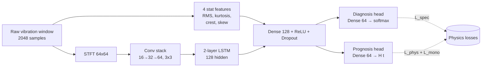

# PINN-PdM — Predictive Maintenance of Industrial Machinery using Physics-Informed Neural Networks

A complete, runnable research codebase implementing **PINN-PdM**, a physics-informed
predictive-maintenance system for rotating machinery, as specified in *Case Study 1*
(problem/data/literature) and *Case Study 2* (model & innovation).

It embeds two governing physics priors into a shared CNN-LSTM backbone:

1. **Bearing characteristic-frequency consistency** (diagnosis) — a differentiable
   spectral loss that anchors each fault-class decision to the theoretical
   defect frequency (BPFO/BPFI/BSF/FTF) of that class.
2. **Degradation ODE + monotonicity** (prognosis) — `dH/dt + ρ·H = 0` enforced by
   automatic differentiation, plus a penalty forbidding health from spontaneously
   increasing.

and benchmarks it against RF/SVM, CNN, LSTM, CNN-LSTM and Transformer baselines,
with a controlled **cross-load extrapolation** protocol (train 0/1/2 HP → test 3 HP).

---

## 1. Project overview

Purely data-driven fault-diagnosis / RUL models saturate in-distribution but degrade
on operating conditions unseen in training and can violate physics (e.g. predicting a
*recovering* bearing). PINN-PdM injects known bearing physics into the loss so
predictions stay physically consistent and generalise better under distribution shift.

## 2. Research question

> Can embedding known physical degradation and vibration-dynamics equations into a
> neural network's loss function improve fault diagnosis and RUL prediction compared
> with purely data-driven baselines, **particularly when evaluating on operating
> conditions not seen during training**?

## 3. Motivation

Case Study 1's survey of 18 papers found that PINNs' extrapolation advantage is
**asserted more often than measured** for discrete rotating machinery. This project
turns that qualitative claim into a controlled, measured experiment.

## 4. Architecture



Composite objective (Case Study 2, §2.5):

```
L = L_data + λ_phys·L_phys + λ_mono·L_mono + λ_spec·L_spec
```

with **self-adaptive** `λ` (gradient-norm balancing, Wang et al. 2021 / SoftAdapt).

## 5. Physics equations

Bearing characteristic defect frequencies (shaft speed `fr`, `n` balls, ball dia `d`,
pitch dia `D`, contact angle `φ`):

```
BPFO = (n/2)·fr·(1 − (d/D)cosφ)      # outer race
BPFI = (n/2)·fr·(1 + (d/D)cosφ)      # inner race
BSF  = (D/2d)·fr·(1 − ((d/D)cosφ)²)  # ball
FTF  = (1/2)·fr·(1 − (d/D)cosφ)      # cage
```

Degradation ODE residual (autodiff in `t`) and monotonicity:

```
r_phys(t) = dH/dt + ρ·H(t) = 0,  ρ>0        L_phys = mean(r_phys²)
L_mono = mean(ReLU(dH/dt)²)
```

`ρ` is **co-estimated** (a learnable, softplus-positive parameter), initialised from a
least-squares fit on the training health trajectories.

## 6. Dataset requirements

| Dataset | Source | Use | Placement |
|---|---|---|---|
| **CWRU** | https://engineering.case.edu/bearingdatacenter | Fault diagnosis | `data/raw/cwru/*.mat` |
| **IMS** | NASA PCoE / U. Cincinnati | RUL / degradation | `data/raw/ims/<test folders>` |
| **C-MAPSS FD001** (optional) | NASA PCoE | RUL stretch | `data/raw/cmapss/*_FD001.txt` |

Datasets are **not** auto-downloaded (they require accepting terms). Run
`python scripts/download_data.py` to print the official sources and create the folders.
**If a dataset is absent, the pipeline uses a documented, physics-consistent synthetic
stand-in** so everything runs end-to-end; such runs are flagged `synthetic_fallback: true`
in the metrics and must not be read as real-data benchmarks.

## 7. Installation

```bash
# Python 3.10+ recommended (code also runs on 3.9)
pip install -r requirements.txt
# or:  conda env create -f environment.yml && conda activate pinn-pdm
```

CUDA / Apple-MPS GPUs are auto-detected; otherwise CPU is used.

## 8. Dataset preparation

```bash
python scripts/download_data.py          # print sources, make folders
python scripts/prepare_cwru.py           # build STFT+feature cache (+ EDA figures)
python scripts/prepare_ims.py
```

## 9. Training

```bash
python scripts/train_baselines.py --dataset cwru      # RF, SVM, CNN, LSTM, CNN-LSTM, Transformer
python scripts/train_pinn.py       --dataset cwru      # PINN-PdM (diagnosis)
python scripts/train_pinn.py       --dataset ims       # PINN-PdM (RUL)
python scripts/train_pinn.py       --dataset synthetic # PINN-PdM (proof-of-concept)
```

## 10. Evaluation

```bash
python scripts/evaluate.py --experiment cwru
python scripts/evaluate.py --experiment ims
```

## 11. Extrapolation experiment (the headline)

`run_experiments.py` trains every model twice — in-distribution (70/15/15) and
cross-condition (train 0/1/2 HP, test **3 HP**) — and reports the accuracy drop:

```bash
python scripts/run_experiments.py --experiment cwru
```

## 12. Ablation study

```bash
python scripts/run_experiments.py --experiment ablation
```
Variants: backbone-only → +ODE → +monotonicity → full PINN (+adaptive weighting).

## 13. Results

Run the full suite, then read the generated report and tables:

```bash
python scripts/run_experiments.py --experiment all      # add --quick for a smoke run
python scripts/generate_report.py
```

Outputs land in `outputs/`:
- `outputs/metrics/*.json` — measured metrics (with `case_study_projected` blocks kept separate)
- `outputs/tables/*.csv` + `outputs/report/tables.md` — Tables 1–6
- `outputs/figures/*.png` — all plots
- `outputs/report/technical_report.md` — full technical report

> **Honesty policy.** Every number in the tables is freshly measured by the code.
> The Case Study's projected targets (e.g. CWRU 3 HP: PINN 95.8%) are shown only in
> clearly-labelled `CS projected` columns and are **never** presented as our
> measurements. If a baseline beats PINN-PdM in a run, the tables show it.

## 14. Folder structure

```
PINN-PdM/
├── config/            # cwru.yaml, ims.yaml, cmapps.yaml, synthetic.yaml
├── src/
│   ├── data/          # loaders, segmentation, preprocessing (STFT), features, splits, synthetic
│   ├── physics/       # bearing_frequencies, degradation, physics_losses, collocation
│   ├── models/        # cnn, lstm, cnn_lstm, transformer, pinn_pdm, common, factory, classical
│   ├── training/      # trainer, pinn_trainer, adaptive_weights, callbacks
│   ├── evaluation/    # classification/rul/physics metrics, extrapolation, ablation, predict
│   ├── visualization/ # signal/training/rul/comparison plots, confusion matrix
│   ├── utils/         # seed, logging, checkpoint, config
│   ├── pipeline.py    # data→split→loader→train orchestration
│   ├── experiments.py # experiment runners
│   └── reporting.py   # tables + technical report
├── scripts/           # CLI entry points
├── tests/             # pytest suite
├── notebooks/         # EDA + results notebooks
└── outputs/           # figures, metrics, tables, report (generated)
```

## 15. Reproducibility

Fixed seeds (`src/utils/seed.py`), deterministic flags, config-driven experiments,
saved checkpoints (`checkpoints/`), metrics JSON, CSV training histories and (optional)
TensorBoard logs. Re-run any experiment with a single command.

## 16. Limitations

- Without the real CWRU/IMS files the pipeline runs on a **synthetic stand-in**; those
  numbers validate the mechanism, not real-data performance.
- The degradation prior is first-order exponential; multi-stage/Paris-law dynamics are
  future work.
- Reported numbers use a modest default training budget; raise `training.epochs` in the
  configs for publication-grade results.

## 17. Future work

Multi-stage degradation priors; validation on long-duration industrial streams with
sensor drift; coupling the physics-residual head with generative models for data-scarce
fault synthesis; a fuller sensitivity study of the self-adaptive weighting.

## 18. References

Key references (full list in the Case Studies): Raissi et al. (2019); Wang, Teng &
Perdikaris (2021); McClenny & Braga-Neto (2023); de Oliveira da Costa et al. (2022,
T4PdM); Saxena et al. (2008, PHM08); Yucesan & Viana (2021); CWRU Bearing Data Center;
NASA IMS / C-MAPSS repositories.

---

*Authors: Vaishvi Verma (23BCE0016), Tanishq Garg (23BCE0094), Sanchit Kumar (23BCE0043).
Guide: Prof. Kalyanaraman P, SCOPE, VIT Vellore.*

---

## Review-03: real-data evaluation (CWRU + MFPT)

The Review-03 manuscript (`paper/main.tex`) reports **only** results measured on the
original recordings; the synthetic fallback is not used anywhere in it.

**Data (not committed; see `.gitignore`)**

- `data/raw/cwru/<id>.mat`: 40 CWRU 12 kHz drive-end files, downloaded from
  `https://engineering.case.edu/sites/default/files/<id>.mat`:
  Normal 97–100; IR 105–108, 169–172, 209–212; Ball 118–121, 185–188, 222–225;
  OR@6 130–133, 197–200, 234–237.
- `data/raw/mfpt/*.mat`: MFPT bearing data. The official MFPT page no longer hosts it;
  we used the Figshare mirror `https://ndownloader.figshare.com/files/53038079`
  (MFPT.zip, md5 `6b86b707f2ab711782492f0dfff0b818`), unzipped in place.

**Run**

```bash
python scripts/run_review03.py --exp all     # audit + every protocol/config/seed (resumable)
python scripts/make_review03_tables.py       # paper/tables/*.tex from outputs/review03/summary.json
python scripts/make_review03_figs.py         # paper/figs/*_real.png, robustness, sensitivity
pytest tests/                                # includes leakage + L_spec gradient tests
```

**Protocols:** the split is made *before* windowing (`src/review03/data_real.py`).
- In-distribution: time blocks of 70/15/15% per recording, with a guard gap.
- Cross-load (0/1/2→3 hp and 0→3 hp): whole 3 hp recordings form the test set.
- MFPT: faults at 0–150 lbs for training, 270/300 lbs for testing.

`assert_no_overlap` fails if any two windows from different splits share a sample.

**Spectral term:** `src/review03/spectral.py` contains the Review-02 form (v1), kept only
for the audit, and the revised form (v2):
- v2 uses a high-resolution raw or squared-envelope spectrum.
- Each class mask has the same total mass.
- The fault-type distribution ignores the healthy logit, and the window weight uses
  stop-gradient.

Each run is cached at `outputs/review03/runs/<exp>/<config>__seed<k>.json`.

### CWRU-PG derived dataset and ablations (faculty request)

```bash
python scripts/build_derived_dataset.py    # -> data/derived/cwru_pg/ (~100 MB, <1 min CPU)
python scripts/evidence_sensitivity.py     # training-free sigma/H sensitivity
```

- CWRU-PG is derived from the 40 real CWRU recordings; no signals are synthesised. See
  `data/derived/cwru_pg/DATASHEET.md`.
- The paper's *Ablation Studies* section (Table "ablation") is computed from the saved
  per-seed runs in `outputs/review03/runs/`; producing it needs no retraining.
